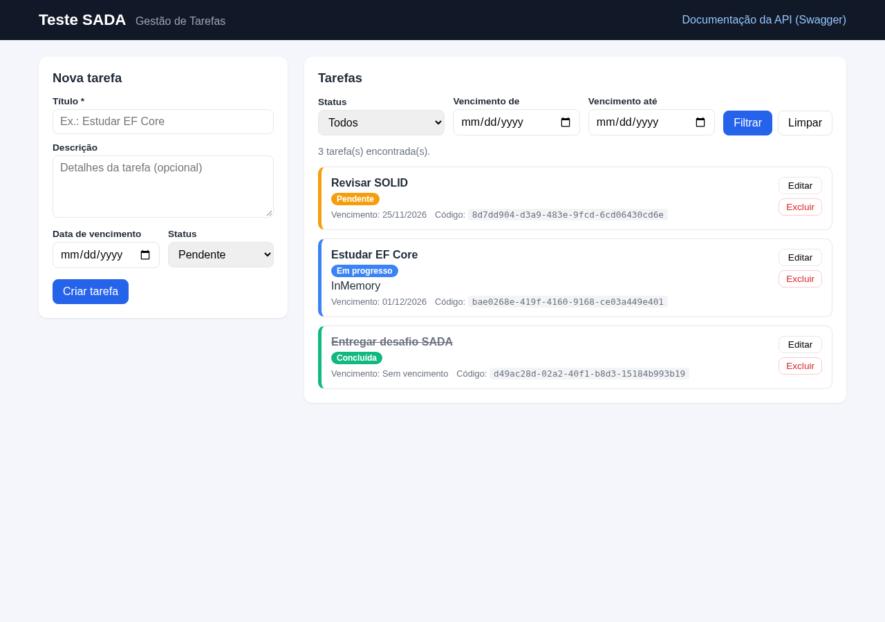

# Teste SADA — Sistema de Gestão de Tarefas

API RESTful em **C# / .NET 8** para criar, listar, filtrar, editar e excluir tarefas, com um **frontend web** (HTML + CSS + JavaScript puro) servido pela própria API.

Utilizado IA de forma auxiliar para poupar alguns trabalhos braçais, arquitetura e estrutura organizada manualmente. (Pelo fato do foco mais no back end frontend ficou bem simples)




---

## Tecnologias

| Item | Tecnologia |
|---|---|
| Framework | .NET 8 / ASP.NET Core Web API (controllers) |
| Persistência | Entity Framework Core 8 — provider **InMemory** (sem banco externo) |
| Validação | FluentValidation 11 |
| Documentação | Swagger (Swashbuckle) com comentários XML |
| Erros | `IExceptionHandler` + `ProblemDetails` (RFC 7807) |
| Logging | `ILogger<T>` nativo do ASP.NET Core (console) |
| Testes | xUnit, Moq, `WebApplicationFactory` (testes de integração) |
| Frontend | HTML, CSS e JavaScript puro (sem build), em `wwwroot` |

## Pré-requisitos

- [.NET SDK 8.0](https://dotnet.microsoft.com/download/dotnet/8.0) ou superior (`dotnet --version`)

## Como rodar

```bash
git clone <url-do-repositorio>
cd TesteSada
dotnet run --project src/TesteSada.Api
```

Depois abra:

| O quê | URL |
|---|---|
| Frontend | http://localhost:5075 |
| Swagger (documentação + testes da API) | http://localhost:5075/swagger |

> Os dados ficam em memória: ao parar a aplicação, as tarefas são apagadas.

## Como rodar os testes

```bash
dotnet test
```

Com cobertura de código (gera `coverage.cobertura.xml` dentro de `tests/TesteSada.Tests/TestResults`):

```bash
dotnet test --collect:"XPlat Code Coverage"
```

São 58 testes, divididos em:

- **Domain** — regras da entidade `TaskItem`.
- **Application/Validators** — regras de validação dos DTOs.
- **Application/Services** — regras de negócio do `TaskService` (repositório mockado com Moq).
- **Infrastructure** — repositório contra o EF Core InMemory (filtros, ordenação, CRUD).
- **Api** — testes de integração HTTP ponta a ponta (status codes 200/201/204/400/404, Swagger e frontend).

## Endpoints

Base: `/api/tasks`

| Método | Rota | Descrição | Respostas |
|---|---|---|---|
| GET | `/api/tasks?status=&dueDateFrom=&dueDateTo=` | Lista tarefas (filtros opcionais e combináveis) | 200, 400 |
| GET | `/api/tasks/{id}` | Busca tarefa pelo código | 200, 404 |
| POST | `/api/tasks` | Cria tarefa e retorna o código único | 201 (+ header `Location`), 400 |
| PUT | `/api/tasks/{id}` | Atualiza título, descrição, vencimento e status | 200, 400, 404 |
| DELETE | `/api/tasks/{id}` | Exclui tarefa | 204, 404 |

**Status aceitos:** `Pendente`, `EmProgresso`, `Concluida` (enviados/recebidos como texto).

### Exemplos (curl)

```bash
# Criar
curl -X POST http://localhost:5075/api/tasks \
  -H "Content-Type: application/json" \
  -d '{"title":"Estudar EF Core","description":"Provider InMemory","dueDate":"2030-12-01","status":"EmProgresso"}'

# Listar pendentes com vencimento em dezembro de 2030
curl "http://localhost:5075/api/tasks?status=Pendente&dueDateFrom=2030-12-01&dueDateTo=2030-12-31"

# Atualizar
curl -X PUT http://localhost:5075/api/tasks/{id} \
  -H "Content-Type: application/json" \
  -d '{"title":"Estudar EF Core","status":"Concluida"}'

# Excluir
curl -X DELETE http://localhost:5075/api/tasks/{id}
```

### Exemplo de erro de validação (400)

```json
{
  "title": "Um ou mais erros de validação ocorreram.",
  "status": 400,
  "instance": "/api/tasks",
  "errors": {
    "Title": ["O título é obrigatório."],
    "DueDate": ["A data de vencimento não pode estar no passado."]
  },
  "traceId": "0HNQ9FJU7Q6BT:00000001"
}
```

### Regras de validação

| Campo | Regra |
|---|---|
| `title` | Obrigatório, até 200 caracteres |
| `description` | Opcional, até 1000 caracteres |
| `dueDate` | Opcional (`yyyy-MM-dd`). Na **criação** não pode estar no passado; na edição é livre (tarefa atrasada continua editável) |
| `status` | `Pendente` (padrão na criação), `EmProgresso` ou `Concluida` |
| filtro | `dueDateFrom` deve ser ≤ `dueDateTo` |

## Arquitetura

Foi usada uma **arquitetura em camadas inspirada na Clean Architecture**:

```
TesteSada.sln
├── src
│   ├── TesteSada.Domain          → Entidade TaskItem e enum TaskItemStatus (sem dependências)
│   ├── TesteSada.Application     → DTOs, interfaces, serviços (regras de negócio), validadores
│   ├── TesteSada.Infrastructure  → EF Core (DbContext InMemory) e implementação do repositório
│   └── TesteSada.Api             → Controllers, tratamento global de erros, Swagger, frontend (wwwroot)
└── tests
    └── TesteSada.Tests           → Testes unitários e de integração (xUnit)
```

Fluxo de uma requisição:

```
Frontend / Swagger ──HTTP──▶ TasksController ──▶ ITaskService (TaskService)
                                                     │  valida (FluentValidation)
                                                     ▼
                                              ITaskRepository (TaskRepository) ──▶ AppDbContext (EF InMemory)
```

Dependências entre projetos (as setas apontam para "quem eu conheço"):

```
Api ──▶ Application ──▶ Domain
 │           ▲
 └──▶ Infrastructure
```

**Por que este modelo?**

- **Separação de responsabilidades:** cada camada tem um papel claro (HTTP, regras de negócio, acesso a dados, domínio).
- **Inversão de dependência:** `Application` define `ITaskRepository`; `Infrastructure` implementa. As regras de negócio não conhecem o EF Core, então trocar o InMemory por SQL Server/PostgreSQL exige mudar apenas a camada de infraestrutura.
- **Testabilidade:** como o serviço depende de interfaces, ele é testado com mocks, sem banco e sem HTTP.
- **Tamanho adequado:** é mais simples que uma Clean Architecture completa (sem CQRS/MediatR), o que é proporcional ao escopo do desafio.

### SOLID no projeto

| Princípio | Onde aparece |
|---|---|
| **S** — Responsabilidade única | Controller só trata HTTP; `TaskService` só regras; `TaskRepository` só dados; cada validador valida um DTO; `GlobalExceptionHandler` só converte erros |
| **O** — Aberto/fechado | Novas regras de validação = novos validadores registrados automaticamente; novos mapeamentos EF = novas classes `IEntityTypeConfiguration` |
| **L** — Substituição de Liskov | Qualquer implementação de `ITaskRepository` (EF, mock do Moq) funciona no `TaskService` |
| **I** — Segregação de interfaces | Interfaces pequenas e específicas (`ITaskService`, `ITaskRepository`, `IValidator<T>`) |
| **D** — Inversão de dependência | Tudo é injetado via construtor como abstração; registros em `AddApplication()` e `AddInfrastructure()` |

## Tratamento de erros e logging

- Exceções são tratadas em um único lugar: `GlobalExceptionHandler`.
  - `ValidationException` → **400** com a lista de erros por campo.
  - `NotFoundException` → **404**.
  - Qualquer outra → **500** com mensagem genérica (o detalhe vai apenas para o log).
- Logs estruturados com `ILogger<T>` (ex.: `Tarefa {TaskId} criada com sucesso.`), níveis configurados em `appsettings.json`.

## Frontend

Página única em `src/TesteSada.Api/wwwroot`, servida em `/`:

- Formulário de criação/edição com exibição das mensagens de validação vindas da API.
- Listagem com filtros por status e intervalo de vencimento.
- Destaque de status por cor, tarefas atrasadas em vermelho e exibição do código único.
- Botões de editar e excluir.

Como é servido pela mesma origem da API, não é necessário configurar CORS nem instalar Node.js.
