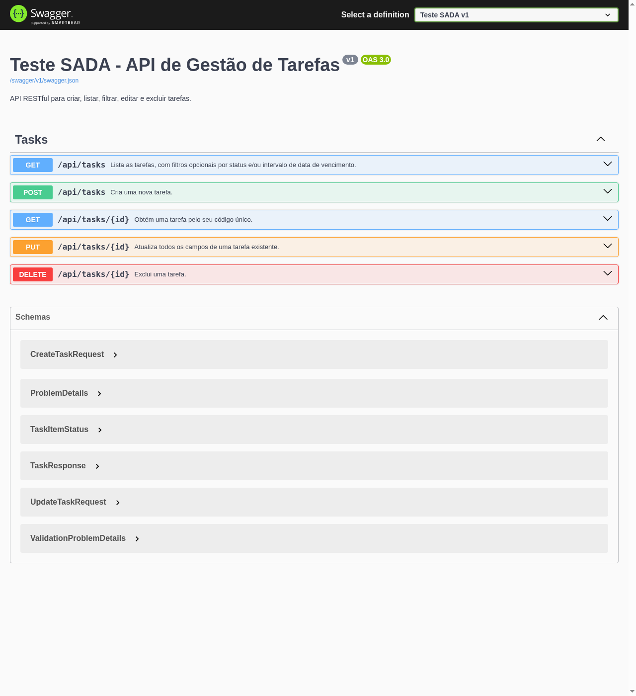

# Guia de Estudo — Teste SADA

Este guia explica **como o projeto foi construído, passo a passo**, e **por que** cada decisão foi tomada. A ideia é que você consiga refazer o projeto do zero e explicá-lo numa entrevista.

Sugestão de ordem de estudo: leia as seções na sequência, abrindo cada arquivo citado ao lado.

---

## Sumário

1. [Visão geral do desafio](#1-visão-geral-do-desafio)
2. [Passo 1 — Criando a solução e os projetos](#2-passo-1--criando-a-solução-e-os-projetos)
3. [Passo 2 — Camada Domain](#3-passo-2--camada-domain)
4. [Passo 3 — Camada Application](#4-passo-3--camada-application)
5. [Passo 4 — Camada Infrastructure](#5-passo-4--camada-infrastructure)
6. [Passo 5 — Camada Api](#6-passo-5--camada-api)
7. [Passo 6 — Frontend](#7-passo-6--frontend)
8. [Passo 7 — Testes automatizados](#8-passo-7--testes-automatizados)
9. [Mapa: requisito do desafio → onde está no código](#9-mapa-requisito-do-desafio--onde-está-no-código)
10. [Conceitos importantes (resumo para revisão)](#10-conceitos-importantes-resumo-para-revisão)
11. [Perguntas prováveis de entrevista](#11-perguntas-prováveis-de-entrevista)
12. [Exercícios para fixar](#12-exercícios-para-fixar)

---

## 1. Visão geral do desafio

O desafio pede uma API de gestão de tarefas com:

- **CRUD** de tarefas (criar, listar, editar, excluir) e **código único** por tarefa.
- **Filtros** por status e/ou data de vencimento.
- .NET 8+, **SOLID**, **EF Core InMemory**, **RESTful**, **Swagger**, **validações**, **testes (xUnit/NUnit)**.
- **DTOs**, **status HTTP corretos**, **camadas bem definidas**, **tratamento de erros** e **logging**.
- README explicando como rodar e a arquitetura escolhida.

O desafio diz que o frontend é opcional; ele foi incluído como extra, de forma simples (sem Node.js), para não aumentar a complexidade.

---

## 2. Passo 1 — Criando a solução e os projetos

Comandos usados (rode na pasta onde quer o projeto):

```bash
# Solução e .gitignore
dotnet new sln -n TesteSada
dotnet new gitignore

# Projetos
dotnet new classlib -n TesteSada.Domain         -o src/TesteSada.Domain         -f net8.0
dotnet new classlib -n TesteSada.Application    -o src/TesteSada.Application    -f net8.0
dotnet new classlib -n TesteSada.Infrastructure -o src/TesteSada.Infrastructure -f net8.0
dotnet new webapi   -n TesteSada.Api            -o src/TesteSada.Api            -f net8.0 --use-controllers
dotnet new xunit    -n TesteSada.Tests          -o tests/TesteSada.Tests        -f net8.0

# Adiciona todos à solução
dotnet sln add src/*/*.csproj tests/*/*.csproj

# Referências entre projetos (define quem pode "enxergar" quem)
dotnet add src/TesteSada.Application    reference src/TesteSada.Domain
dotnet add src/TesteSada.Infrastructure reference src/TesteSada.Application src/TesteSada.Domain
dotnet add src/TesteSada.Api            reference src/TesteSada.Application src/TesteSada.Infrastructure
dotnet add tests/TesteSada.Tests        reference src/TesteSada.Domain src/TesteSada.Application src/TesteSada.Infrastructure src/TesteSada.Api

# Pacotes NuGet
dotnet add src/TesteSada.Application    package FluentValidation --version 11.9.2
dotnet add src/TesteSada.Application    package FluentValidation.DependencyInjectionExtensions --version 11.9.2
dotnet add src/TesteSada.Application    package Microsoft.Extensions.Logging.Abstractions --version 8.0.2
dotnet add src/TesteSada.Infrastructure package Microsoft.EntityFrameworkCore.InMemory --version 8.0.11
dotnet add src/TesteSada.Infrastructure package Microsoft.Extensions.Configuration.Abstractions --version 8.0.0
dotnet add tests/TesteSada.Tests        package Moq --version 4.20.72
dotnet add tests/TesteSada.Tests        package Microsoft.AspNetCore.Mvc.Testing --version 8.0.11
dotnet add tests/TesteSada.Tests        package Microsoft.EntityFrameworkCore.InMemory --version 8.0.11
```

Depois foram apagados os arquivos de exemplo gerados pelos templates (`Class1.cs`, `WeatherForecast*`, `UnitTest1.cs`).

### Por que 4 projetos e não 1?

Projetos separados **forçam** a arquitetura: o compilador impede, por exemplo, que o `Domain` use EF Core, porque o `Domain` não referencia o pacote. Numa pasta única isso dependeria só de disciplina.

```
Api ──▶ Application ──▶ Domain
 │           ▲
 └──▶ Infrastructure
```

- **Domain** não depende de ninguém (é o "coração").
- **Application** só conhece o Domain. Ela **define interfaces** (ex.: `ITaskRepository`) que outros implementam.
- **Infrastructure** implementa as interfaces da Application usando EF Core.
- **Api** é o ponto de entrada: junta tudo (é a "composition root", onde a injeção de dependência é configurada).

---

## 3. Passo 2 — Camada Domain

Arquivos:

- `src/TesteSada.Domain/Enums/TaskItemStatus.cs`
- `src/TesteSada.Domain/Entities/TaskItem.cs`

### 3.1 O enum `TaskItemStatus`

```csharp
public enum TaskItemStatus { Pendente = 0, EmProgresso = 1, Concluida = 2 }
```

Representa os 3 status pedidos. Na API ele trafega como **texto** (`"Pendente"`) por causa do `JsonStringEnumConverter` configurado no `Program.cs`.

### 3.2 A entidade `TaskItem`

Pontos importantes:

- **Nome `TaskItem`, não `Task`**: `Task` conflitaria com `System.Threading.Tasks.Task` (usado em todo método `async`).
- **`Id` do tipo `Guid`**: é o "código único" pedido. É gerado pela própria entidade (`Guid.NewGuid()`), então o código existe antes mesmo de salvar no banco.
- **Setters privados** (`{ get; private set; }`): ninguém de fora altera as propriedades diretamente. Mudanças só pelos métodos `Create` e `Update`. Isso é **encapsulamento** — a entidade garante que nunca fica num estado inválido (ex.: sem título).
- **Factory method `Create(...)`**: centraliza a criação e as invariantes (título obrigatório, `Trim()`, descrição vazia vira `null`).
- **Construtor privado vazio**: o EF Core precisa dele para materializar objetos vindos do banco.
- **`DateOnly` para `DueDate`**: vencimento é uma data, sem hora. Evita problemas de fuso horário.
- **`CreatedAt` / `UpdatedAt`**: auditoria simples. A data vem de fora (parâmetro) em vez de `DateTime.UtcNow` dentro da entidade — assim os testes controlam o "agora".

---

## 4. Passo 3 — Camada Application

É onde ficam as **regras de negócio** (casos de uso). Pastas:

| Pasta | Conteúdo |
|---|---|
| `DTOs/` | `CreateTaskRequest`, `UpdateTaskRequest`, `TaskFilter`, `TaskResponse` |
| `Interfaces/` | `ITaskService`, `ITaskRepository` |
| `Services/` | `TaskService` |
| `Validators/` | `CreateTaskRequestValidator`, `UpdateTaskRequestValidator`, `TaskFilterValidator`, `TaskRules` |
| `Exceptions/` | `NotFoundException` |
| `Mappings/` | `TaskMappings` (entidade → DTO) |
| raiz | `DependencyInjection.cs` (`AddApplication()`) |

### 4.1 DTOs (Data Transfer Objects)

DTOs são objetos simples que definem **o contrato da API** — o que entra e o que sai.

Por que não expor a entidade direto?

- O cliente não pode enviar `Id`, `CreatedAt` etc. — o `CreateTaskRequest` simplesmente não tem esses campos.
- Mudar a entidade (ex.: novo campo interno) não quebra quem consome a API.
- Cada operação tem seu formato: criação, edição, filtro e resposta são diferentes.

Foram usados **`record`** porque DTOs são imutáveis e só carregam dados. Os comentários `/// <summary>` e `/// <example>` aparecem no Swagger.

### 4.2 Interfaces

```csharp
public interface ITaskRepository { GetAllAsync, GetByIdAsync, AddAsync, UpdateAsync, DeleteAsync }
public interface ITaskService    { GetAllAsync, GetByIdAsync, CreateAsync, UpdateAsync, DeleteAsync }
```

`ITaskRepository` fica na **Application** (e não na Infrastructure). Esse é o ponto-chave da **Inversão de Dependência (o "D" do SOLID)**: a regra de negócio define o que precisa, e a infraestrutura se adapta.

Todos os métodos recebem `CancellationToken`: se o cliente desistir da requisição, o ASP.NET cancela o token e as operações assíncronas param, poupando recursos.

### 4.3 Validação com FluentValidation

Exemplo (`CreateTaskRequestValidator`):

```csharp
RuleFor(x => x.Title).NotEmpty().MaximumLength(TaskRules.TitleMaxLength);
RuleFor(x => x.Description).MaximumLength(TaskRules.DescriptionMaxLength);
RuleFor(x => x.Status).IsInEnum();
RuleFor(x => x.DueDate)
    .Must(d => d >= DateOnly.FromDateTime(timeProvider.GetUtcNow().UtcDateTime))
    .When(x => x.DueDate.HasValue);
```

Por que FluentValidation e não `[Required]` (DataAnnotations)?

- Regras ficam **fora** do DTO (responsabilidade única).
- Regras complexas ficam legíveis (`When`, `Must`, comparação entre campos).
- É **fácil de testar** isoladamente (`validator.Validate(obj)`).

Detalhes:

- **`TimeProvider`** (novo no .NET 8) é uma abstração do relógio. Em produção usamos `TimeProvider.System`; nos testes, um `FakeTimeProvider` com data fixa. Sem isso, o teste "data no passado" poderia quebrar dependendo do dia em que roda.
- **Data passada só é bloqueada na criação.** Na edição é permitida, senão uma tarefa atrasada nunca mais poderia ser editada (ex.: para marcar como concluída).
- **`TaskRules`** guarda os limites (200 / 1000) num lugar só; é usado pelos validadores e pelo mapeamento do EF.
- **`TaskFilterValidator`** garante `dueDateFrom <= dueDateTo`.

### 4.4 `TaskService` — as regras de negócio

Fluxo do `CreateAsync`:

1. `await _createValidator.ValidateAndThrowAsync(request)` → se inválido, lança `ValidationException` (vira 400).
2. `TaskItem.Create(...)` → cria a entidade com `Id` novo e `CreatedAt` vindo do `TimeProvider`.
3. `await _repository.AddAsync(task)` → persiste.
4. `_logger.LogInformation("Tarefa {TaskId} criada...", task.Id)` → log estruturado.
5. `return task.ToResponse()` → devolve DTO, nunca a entidade.

`UpdateAsync`, `GetByIdAsync` e `DeleteAsync` usam o método privado `GetExistingTaskAsync`, que lança `NotFoundException` (vira 404) quando a tarefa não existe — sem duplicar código (DRY).

Repare que o serviço **não sabe nada de HTTP** (não retorna `NotFound()`, `BadRequest()`): ele lança exceções de negócio e a camada Api decide o status code. Isso mantém o serviço reutilizável (ex.: num worker ou numa CLI).

**Log estruturado:** `"{TaskId}"` não é interpolação de string; é um placeholder. Ferramentas como Seq/Elastic indexam `TaskId` como campo pesquisável.

### 4.5 `DependencyInjection.AddApplication()`

```csharp
services.AddSingleton(TimeProvider.System);
services.AddValidatorsFromAssembly(typeof(DependencyInjection).Assembly); // registra todos os validadores
services.AddScoped<ITaskService, TaskService>();
```

Cada camada registra as próprias dependências num método de extensão; o `Program.cs` só chama `AddApplication()` e `AddInfrastructure()`. Fica limpo e cada camada é dona da sua configuração.

**Tempos de vida (lifetimes) da DI:**

| Lifetime | Instância | Usado em |
|---|---|---|
| Singleton | Uma para a aplicação toda | `TimeProvider` |
| Scoped | Uma por requisição HTTP | `TaskService`, `TaskRepository`, `AppDbContext` |
| Transient | Uma nova a cada injeção | (não usado aqui) |

`DbContext` **deve** ser Scoped: ele não é thread-safe e guarda estado (change tracker) da requisição.

---

## 5. Passo 4 — Camada Infrastructure

Arquivos:

- `Persistence/AppDbContext.cs`
- `Persistence/Configurations/TaskItemConfiguration.cs`
- `Repositories/TaskRepository.cs`
- `DependencyInjection.cs` (`AddInfrastructure()`)

### 5.1 `AppDbContext`

```csharp
public DbSet<TaskItem> Tasks => Set<TaskItem>();
protected override void OnModelCreating(ModelBuilder mb) =>
    mb.ApplyConfigurationsFromAssembly(typeof(AppDbContext).Assembly);
```

`ApplyConfigurationsFromAssembly` encontra sozinho todas as classes `IEntityTypeConfiguration<T>` — adicionar entidade nova não exige mexer no DbContext (Aberto/Fechado).

### 5.2 `TaskItemConfiguration` (Fluent API)

Define chave, tamanhos máximos e grava o `Status` como texto (`HasConversion<string>()`). Usar Fluent API em vez de atributos (`[Key]`, `[MaxLength]`) mantém o **Domain livre de dependência do EF**.

### 5.3 `TaskRepository`

```csharp
IQueryable<TaskItem> query = _context.Tasks.AsNoTracking();
if (filter.Status.HasValue)      query = query.Where(t => t.Status == filter.Status.Value);
if (filter.DueDateFrom.HasValue) query = query.Where(t => t.DueDate >= filter.DueDateFrom.Value);
if (filter.DueDateTo.HasValue)   query = query.Where(t => t.DueDate <= filter.DueDateTo.Value);
return await query.OrderBy(t => t.DueDate == null).ThenBy(t => t.DueDate).ThenBy(t => t.CreatedAt).ToListAsync();
```

- **`IQueryable` composto**: os `Where` vão sendo empilhados e só executam no `ToListAsync()`. Num banco real, vira **um único SQL** com `WHERE` — o filtro acontece no banco, não na memória.
- **`AsNoTracking()`**: na listagem não vamos alterar nada, então o EF não precisa rastrear mudanças (mais rápido).
- **Ordenação**: por vencimento, com tarefas sem data no fim.

### 5.4 `AddInfrastructure()`

```csharp
var databaseName = configuration["Database:InMemoryName"] ?? "TesteSadaDb";
services.AddDbContext<AppDbContext>(o => o.UseInMemoryDatabase(databaseName));
services.AddScoped<ITaskRepository, TaskRepository>();
```

**Trocar para SQL Server** no futuro = mudar `UseInMemoryDatabase` para `UseSqlServer(connectionString)` e criar migrations. Nenhuma linha da Application ou da Api muda. Esse é o benefício prático da arquitetura.

> Atenção: o InMemory **não** é um banco relacional (não tem transações reais, constraints, etc.). Serve para desenvolvimento e testes, como o desafio pede.

---

## 6. Passo 5 — Camada Api

Arquivos:

- `Program.cs`
- `Controllers/TasksController.cs`
- `ErrorHandling/GlobalExceptionHandler.cs`
- `appsettings.json`, `Properties/launchSettings.json`
- `TesteSada.Api.csproj` (com `GenerateDocumentationFile`)

### 6.1 `TasksController` — RESTful

| Verbo | Rota | Sucesso | Erros |
|---|---|---|---|
| GET | `/api/tasks` | 200 | 400 |
| GET | `/api/tasks/{id:guid}` | 200 | 404 |
| POST | `/api/tasks` | **201 Created** + header `Location` | 400 |
| PUT | `/api/tasks/{id:guid}` | 200 | 400, 404 |
| DELETE | `/api/tasks/{id:guid}` | **204 No Content** | 404 |

Princípios REST aplicados:

- **Recurso no plural** (`/tasks`), ação definida pelo **verbo HTTP**, não pela URL (nada de `/criarTarefa`).
- **POST retorna 201** e o header `Location` com a URL do novo recurso (`CreatedAtRoute`).
- **DELETE retorna 204** (sucesso sem corpo).
- **Filtros via query string** (`?status=Pendente&dueDateFrom=...`), ligados ao DTO `TaskFilter` por `[FromQuery]`.
- **`{id:guid}`**: route constraint — `/api/tasks/abc` nem chega no controller (404).

Controller "magro": cada action tem 2 linhas (chama o serviço e devolve o resultado). Não há `try/catch` — erros sobem para o tratador global.

`[ApiController]` traz comportamentos automáticos: valida o model binding (ex.: `"status": "Inexistente"` ou JSON malformado → 400 automático) e infere `[FromBody]`/`[FromQuery]`.

`[ProducesResponseType]` e comentários `///` documentam no Swagger cada resposta possível.

### 6.2 `GlobalExceptionHandler` — tratamento de erros centralizado

Implementa `IExceptionHandler` (novidade do .NET 8):

```csharp
ProblemDetails problem = exception switch
{
    ValidationException ve => CreateValidationProblem(ve),            // 400 + erros por campo
    NotFoundException      => new ProblemDetails { Status = 404, ... },
    _                      => new ProblemDetails { Status = 500, ... } // sem vazar detalhes internos
};
```

- Resposta padronizada **ProblemDetails (RFC 7807)**, formato que o próprio ASP.NET usa.
- Erros 4xx são logados como `Warning`; 500 como `Error` **com a stack trace** (só no log, nunca na resposta — segurança).
- Inclui `traceId` para correlacionar a resposta com a linha do log.

Registro no `Program.cs`: `AddExceptionHandler<GlobalExceptionHandler>()`, `AddProblemDetails()` e `app.UseExceptionHandler()`.

### 6.3 `Program.cs` — composição e pipeline

Duas partes:

**Serviços (o que existe):**

```csharp
builder.Services.AddApplication();
builder.Services.AddInfrastructure(builder.Configuration);
builder.Services.AddExceptionHandler<GlobalExceptionHandler>();
builder.Services.AddProblemDetails();
builder.Services.AddControllers().AddJsonOptions(o =>
    o.JsonSerializerOptions.Converters.Add(new JsonStringEnumConverter()));
builder.Services.AddSwaggerGen(...); // título, descrição e comentários XML
```

**Pipeline/middlewares (a ordem importa):**

```csharp
app.UseExceptionHandler(); // 1º: precisa "envolver" tudo para capturar exceções
app.UseSwagger(); app.UseSwaggerUI();
app.UseDefaultFiles();     // "/" → "/index.html"
app.UseStaticFiles();      // serve wwwroot (frontend)
app.MapControllers();
```

O Swagger fica habilitado em qualquer ambiente para facilitar a avaliação. Num sistema real, normalmente se restringe a `Development`.

`public partial class Program;` no final permite que o projeto de testes use `WebApplicationFactory<Program>`.

### 6.4 Swagger com comentários XML

No `.csproj` da Api e da Application:

```xml
<GenerateDocumentationFile>true</GenerateDocumentationFile>
<NoWarn>$(NoWarn);1591</NoWarn>  <!-- não avisar sobre membros públicos sem comentário -->
```

O compilador gera `TesteSada.Api.xml` e `TesteSada.Application.xml`; o `AddSwaggerGen` lê esses arquivos com `IncludeXmlComments`. Resultado: descrições, exemplos e códigos de resposta aparecem no Swagger.



---

## 7. Passo 6 — Frontend

Arquivos em `src/TesteSada.Api/wwwroot`:

| Arquivo | Papel |
|---|---|
| `index.html` | Estrutura: formulário (criar/editar), filtros, lista |
| `css/styles.css` | Visual: layout em grid, cores por status, responsivo |
| `js/app.js` | Lógica: chamadas à API com `fetch`, renderização da lista, edição/exclusão |

Decisões:

- **Sem framework e sem build**: para um projeto focado em backend, evita exigir Node.js. Basta `dotnet run`.
- **Mesma origem da API**: o frontend é servido pela própria API (`UseStaticFiles`), então **não precisa de CORS**.
- **Organização do `app.js`:**
  - `request()` — wrapper do `fetch` que transforma respostas de erro (ProblemDetails) em exceção com a lista de mensagens.
  - `api` — um objeto com `list`, `get`, `create`, `update`, `remove` (uma "camada de acesso à API").
  - `renderTasks()` — monta a lista usando `textContent` (e não `innerHTML`) para os dados do usuário, o que **evita XSS**.
  - Handlers de eventos para submit do formulário, filtros, editar, excluir.
- **Validação exibida no formulário**: as mensagens vêm da API (fonte única da verdade), então frontend e backend nunca divergem.

---

## 8. Passo 7 — Testes automatizados

Projeto `tests/TesteSada.Tests` — **58 testes** (`dotnet test`).

| Pasta | Tipo | O que testa |
|---|---|---|
| `Domain/TaskItemTests.cs` | Unitário | Criação, Id único, trim, título obrigatório, Update |
| `Application/Validators/*` | Unitário | Cada regra de validação (título, descrição, data, status, intervalo) |
| `Application/Services/TaskServiceTests.cs` | Unitário com **mock** | Regras do serviço: cria, busca, atualiza, exclui, 404, validação |
| `Infrastructure/TaskRepositoryTests.cs` | Integração (EF InMemory) | Filtros por status/data, combinação, ordenação, CRUD |
| `Api/TasksControllerTests.cs` | Integração HTTP | Status codes 200/201/204/400/404, header Location, Swagger e frontend |
| `Helpers/FakeTimeProvider.cs` | Apoio | Relógio fixo para testes determinísticos |

### 8.1 Padrão AAA

Todos os testes seguem **Arrange / Act / Assert** (preparar, executar, verificar), separados por linhas em branco.

Nomes no formato `Metodo_Cenario_ResultadoEsperado`, ex.: `CreateAsync_InvalidRequest_ShouldThrowValidationAndNotPersist`.

### 8.2 Mock com Moq (testes do serviço)

```csharp
_repository.Setup(r => r.GetByIdAsync(task.Id, It.IsAny<CancellationToken>())).ReturnsAsync(task);
await _service.DeleteAsync(task.Id);
_repository.Verify(r => r.DeleteAsync(task, It.IsAny<CancellationToken>()), Times.Once);
```

- `Setup(...).ReturnsAsync(...)`: "quando chamarem isso, devolva aquilo".
- `Verify(..., Times.Once/Never)`: confere se o serviço chamou (ou **não** chamou) o repositório. Ex.: com dados inválidos, `AddAsync` deve ser chamado `Times.Never`.

Só é possível mockar porque o `TaskService` depende da **interface** `ITaskRepository` — é a DI/SOLID mostrando valor na prática.

`[Fact]` = um teste. `[Theory]` + `[InlineData]` = mesmo teste com vários dados.

### 8.3 Testes de integração com `WebApplicationFactory`

`CustomWebApplicationFactory` sobe a API inteira em memória e troca o banco por um InMemory com nome único (isolamento entre execuções). O `HttpClient` faz requisições reais:

```csharp
var response = await _client.DeleteAsync($"/api/tasks/{created.Id}");
Assert.Equal(HttpStatusCode.NoContent, response.StatusCode);
```

Isso valida tudo junto: rotas, model binding, serialização de enum como texto, validação, tratamento de erros e status codes.

### 8.4 Cobertura

```bash
dotnet test --collect:"XPlat Code Coverage"
```

Para ver um relatório HTML (opcional):

```bash
dotnet tool install -g dotnet-reportgenerator-globaltool
reportgenerator -reports:"tests/**/coverage.cobertura.xml" -targetdir:coverage-report
```

---

## 9. Mapa: requisito do desafio → onde está no código

| Requisito | Onde |
|---|---|
| Criar tarefa com título, descrição, vencimento, status | `CreateTaskRequest`, `TaskService.CreateAsync`, `POST /api/tasks` |
| Retornar código único | `TaskItem.Create` (`Guid.NewGuid()`), resposta 201 com `id` |
| Listar todas | `GET /api/tasks`, `TaskRepository.GetAllAsync` |
| Filtrar por status e/ou vencimento | `TaskFilter`, query string, `Where` no repositório |
| Editar | `PUT /api/tasks/{id}`, `TaskItem.Update` |
| Excluir | `DELETE /api/tasks/{id}` |
| .NET 8 | todos os `.csproj` (`net8.0`) |
| SOLID | ver tabela no README |
| EF Core InMemory | `Infrastructure/DependencyInjection.cs`, `AppDbContext` |
| RESTful | `TasksController` |
| Swagger | `Program.cs` + comentários XML |
| Validações | `Application/Validators` + `[ApiController]` |
| Testes xUnit | `tests/TesteSada.Tests` |
| DTOs | `Application/DTOs` |
| Status HTTP corretos | `TasksController` + `GlobalExceptionHandler` |
| Camadas | 4 projetos em `src/` |
| Tratamento de erros | `GlobalExceptionHandler` |
| Logging | `ILogger<T>` no `TaskService` e no `GlobalExceptionHandler` |
| README | `README.md` |

---

## 10. Conceitos importantes (resumo para revisão)

- **Injeção de Dependência (DI):** a classe recebe o que precisa pelo construtor, em vez de criar com `new`. O container do ASP.NET monta tudo. Benefício: baixo acoplamento e testes com mocks.
- **Repository Pattern:** esconde os detalhes de acesso a dados atrás de uma interface.
- **DTO:** objeto de transporte; define o contrato da API e protege a entidade.
- **Factory Method:** `TaskItem.Create(...)` — criação controlada da entidade.
- **Middleware / pipeline:** cada requisição passa por uma sequência de componentes; a ordem de registro é a ordem de execução.
- **ProblemDetails:** formato padrão (RFC 7807) para erros HTTP.
- **async/await:** libera a thread enquanto espera I/O (banco, rede), aumentando a capacidade do servidor.
- **CancellationToken:** permite cancelar operações quando o cliente desiste.
- **IQueryable vs IEnumerable:** `IQueryable` monta a consulta e executa no banco; `IEnumerable` filtra em memória.
- **AsNoTracking:** leitura sem rastreamento de mudanças — mais performática.
- **TimeProvider:** abstração do relógio, para testes determinísticos.
- **Teste unitário vs integração:** unitário testa uma classe isolada (com mocks); integração testa várias partes reais juntas.

---

## 11. Perguntas prováveis de entrevista

**Por que escolheu essa arquitetura?**
Separação clara de responsabilidades, inversão de dependência (regras de negócio não dependem do EF) e testabilidade. É proporcional ao tamanho do desafio — sem a cerimônia de CQRS/MediatR.

**Onde fica a validação? Por que não no controller?**
Na Application (FluentValidation, chamada pelo serviço). Assim a regra vale para qualquer ponto de entrada, não só HTTP, e é testável sem subir a API.

**Como a API devolve 404 se o serviço não conhece HTTP?**
O serviço lança `NotFoundException`; o `GlobalExceptionHandler` converte em 404 com ProblemDetails.

**Como trocaria o InMemory por SQL Server?**
Instalar `Microsoft.EntityFrameworkCore.SqlServer`, trocar `UseInMemoryDatabase` por `UseSqlServer` em `AddInfrastructure`, criar migrations (`dotnet ef migrations add Inicial`). Application e Api não mudam.

**Por que `Guid` e não `int` como Id?**
É gerado pela aplicação (sem ida ao banco), é único globalmente e não expõe quantas tarefas existem nem permite "adivinhar" IDs sequenciais.

**Por que DELETE retorna 204 e POST 201?**
201 indica recurso criado (com `Location`); 204 indica sucesso sem conteúdo no corpo.

**Por que `DbContext` é Scoped?**
Não é thread-safe e mantém estado da unidade de trabalho; uma instância por requisição é o padrão.

**O que é testado com mock e o que é testado "de verdade"?**
O serviço é testado com o repositório mockado (regra pura). O repositório é testado contra o EF InMemory. A API é testada ponta a ponta com `WebApplicationFactory`.

---

## 12. Exercícios para fixar

1. Adicionar um campo **Prioridade** (`Baixa`, `Media`, `Alta`): enum no Domain, DTOs, validador, configuração EF, frontend e testes.
2. Criar o endpoint **`PATCH /api/tasks/{id}/status`** que altera só o status.
3. Adicionar **busca por texto** no título (`?search=`) no `TaskFilter` e no repositório.
4. Implementar **paginação** (`?page=1&pageSize=10`) retornando também o total de itens.
5. Trocar o InMemory por **SQLite** e criar a primeira migration.
6. Adicionar um teste que verifica que o `TaskService` **loga** ao criar uma tarefa (mock de `ILogger`).
